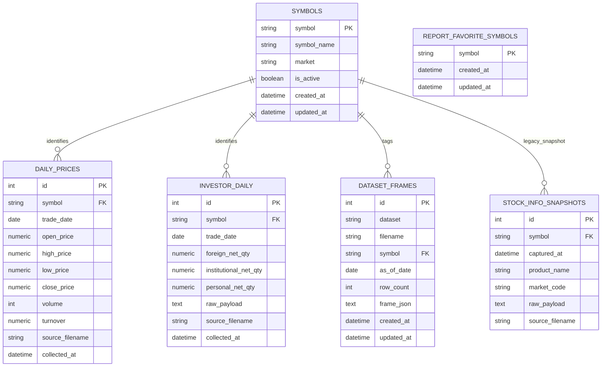

# invest_bot DB migration ERD

> OKF 상태는 `review-required`다. 2026-11-26에 관심종목 테이블을 모델과 마이그레이션에 맞춰 추가했다. [현재 저장 경계](../knowledge/concepts.md#저장-경계와-알려진-문서-차이)

## Purpose

이 문서는 **현재 코드 기준 실제 테이블 관계를 간략히 보여주는 보조 문서**다. 세부 책임과 사용자 변경 경계는 [`db_schema.md`](./db_schema.md)를 canonical source로 본다.

## Tables

관리 대상 테이블은 `symbols`, `daily_prices`, `investor_daily`, `dataset_frames`, `stock_info_snapshots`, `report_favorite_symbols`다. 아래 ERD는 각 테이블의 주요 컬럼과 현재 관계를 요약한다.

## Relationships

## Constraints

- `symbols.symbol`은 종목 기준 primary key다.
- `daily_prices`는 `symbol + trade_date` unique constraint로 일별 가격 중복을 막는다.
- `investor_daily`는 `symbol + trade_date` unique constraint로 일별 수급 중복을 막는다.
- `dataset_frames`는 `dataset + filename` unique constraint로 snapshot 중복을 막는다.
- `daily_prices`, `investor_daily`, `stock_info_snapshots`의 종목 FK에는 `ON DELETE CASCADE`가 적용된다. `dataset_frames.symbol`은 nullable FK이며 종목 삭제 시 NULL로 바뀐다.
- `stock_info_snapshots`에는 `symbol + captured_at` unique constraint가 있다.
- `report_favorite_symbols.symbol`은 기본키이며 종목 FK가 없는 별도 테이블이다.

## Ownership notes

- `symbols`는 canonical 종목 reference다.
- `daily_prices`, `investor_daily`는 정규화된 fact table이다.
- `dataset_frames`는 raw/derived snapshot store다.
- `stock_info_snapshots`는 현재 정책 기준 **deprecated candidate**다.

## Migration direction

- 사용자 종목 검색/조회 source는 `symbols`로 단일화한다.
- `dataset_frames.stock_info`는 canonical source에서 제외한다.
- `stock_info_snapshots`는 후속 migration에서 제거 후보로 다룬다.
