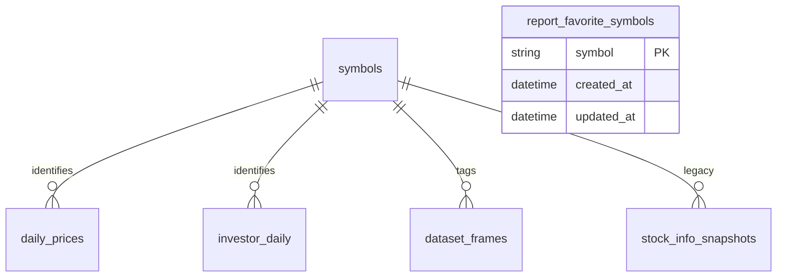

# invest_bot DB ERD operational summary

> OKF 상태는 `review-required`다. 2026-11-26에 관심종목과 종목 placeholder를 명시했다. [현재 구현 근거](../knowledge/concepts.md#저장-경계와-알려진-문서-차이)

이 문서는 운영 관점에서 보는 간단한 ERD 요약이다. 세부 컬럼 정의와 write boundary는 [`../architecture/db_schema.md`](../architecture/db_schema.md)를 기준으로 본다.

## Operational interpretation

- `symbols`는 사용자 lookup의 canonical reference다.
- `daily_prices`, `investor_daily`는 수집 결과 fact table이다.
- `dataset_frames`는 preview/artifact/snapshot 저장소다.
- `stock_info_snapshots`는 제거 후보로 분류된 테이블이다.
- `report_favorite_symbols`는 종목 FK 없이 사용자의 명시적 관심종목 선택을 저장한다.

## Write boundary

- 사용자 조회: write 없음
- 수집 실행은 raw snapshot을 저장한다. `enable_db_write`가 켜지면 `daily_prices`와 `investor_daily`도 저장할 수 있다.
- 분석·리포트 실행은 processed `dataset_frames`를 저장한다.
- 종목 마스터 동기화가 `symbols`의 종목명·시장을 관리한다. fact와 종목 snapshot 저장은 미등록 종목의 placeholder를 만들 수 있다.
- 관심종목 버튼은 `report_favorite_symbols`에 명시적으로 추가·제거한다.
